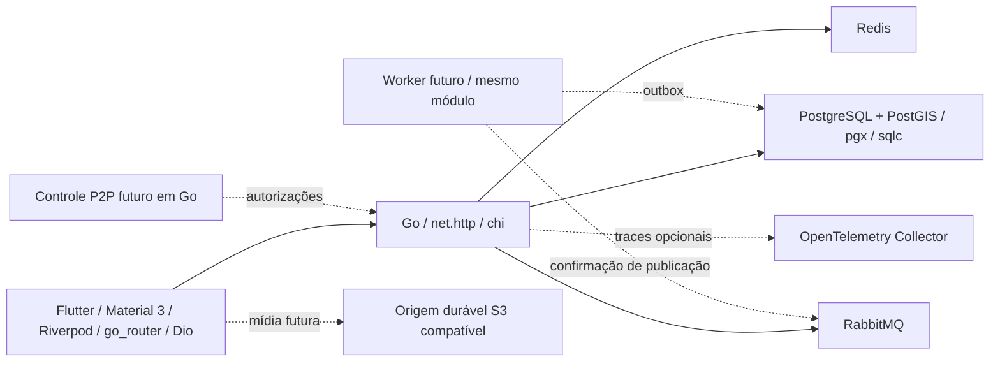

# Visão do sistema

Flow V1 é uma plataforma social contextual a experiências e localização. PR-00 estabelece infraestrutura; não entrega funcionalidades de negócio.

## Organização e dependências

`apps/mobile` contém a base nova, porque o repositório fornecido está vazio (ver auditoria). `backend` é um módulo Go; API e ferramenta de migração são os executáveis operacionais. Worker e gateway possuem apenas documentação, sem processos fictícios. `contracts` guarda OpenAPI e envelopes versionados. `infra` contém o ambiente local e observabilidade opcional. ADRs registram decisões de impacto.

Domínio → contratos/interfaces de aplicação; adaptadores HTTP, pgx, Redis e RabbitMQ dependem da aplicação. `cmd/api` compõe adaptadores e configuração. `internal/platform` atende preocupações técnicas transversais e não importa módulos de negócio. Módulos futuros não acessam tabelas de outro módulo diretamente; compõem casos de uso por interfaces pequenas ou eventos após commit. Não criar uma interface por struct nem pastas vazias para cada domínio.

## Operação e segurança

API usa timeouts de cabeçalho/leitura/escrita/idle, limite de cabeçalhos e corpo, JSON estruturado com ID de requisição e trace ID. URLs, queries, corpos, cabeçalhos, telefone, localização e erros crus de dependências não entram em logs. Não habilita CORS amplo ou confiança implícita em `X-Forwarded-*`. TLS público, rate limiting de borda e configuração de proxy confiável serão requisitos do ambiente de publicação; o Compose é apenas local.

`/healthz` sinaliza processo vivo; não consulta dependências. `/readyz` retorna 503 se PostgreSQL, Redis ou RabbitMQ falharem ou se o processo estiver encerrando; não revela nomes de hosts/credenciais. API pode iniciar durante falha temporária, mas permanece não pronta. Compose aguarda serviços saudáveis e migração bem-sucedida. SIGTERM/SIGINT removem readiness e aguardam requisições em andamento; após o prazo fecham conexões.

Configuração valida ambiente, URLs, limites e deadlines. Produção exige PostgreSQL `verify-full`, Redis `rediss`, RabbitMQ `amqps` e HTTPS em OTLP se habilitado; certificados e segredos vêm do ambiente/secret manager. `FLOW_ENV=production` não torna este Compose adequado para produção.

OTel cria spans HTTP com propagação W3C, amostragem de 10% com respeito ao parent e exportação OTLP HTTP opcional. Spans não contêm parâmetros pessoais. Collector local apenas recebe e imprime resumos; não há promessa de métricas, dashboards, alertas, APM ou armazenamento durável nesta fase. Restringir exposição dos probes na borda de produção.

## Consistência

PostgreSQL é fonte de verdade. Redis serve estado descartável; não decide permissões. RabbitMQ terá entrega ao menos uma vez. A transação de domínio inclui AppendOutbox via consultas sqlc ligadas ao mesmo `pgx.Tx`. Consumidor insere `(consumer,event_id)` na inbox e aplica o efeito no mesmo commit. Duplicata gera `pgx.ErrNoRows` e deve ignorar efeitos; falha reverte ambos. Confirmar ACK somente depois do commit.

Relay, publisher confirms, leases, retries com backoff, DLQ, replay e limpeza só serão implementados junto do primeiro evento real. Não há entrega assíncrona em funcionamento no PR-00. O rollback inicial remove somente schema/tabelas técnicas e preserva PostGIS por ser extensão compartilhada.

## Mobile

Bootstrap valida `--dart-define`, injeta configuração em Riverpod, inicializa tratamento central de falhas sanitizadas e usa `MaterialApp.router`. Dio tem timeouts, Accept JSON e sem logs de payload. SecureStore encapsula armazenamento nativo; nenhum token é escrito na inicialização. AuthState começa em `unknown`; interfaces não implementam login ou autorização. A única rota disponível é a base `/`; erro de navegação permite recuperação.

Material 3 usa tokens de cor, tipografia, espaçamento, raio e movimento, tema claro/escuro, cards, botões, campos, sheets e estados reutilizáveis. Gradiente azul/roxo/rosa é decorativo, sem texto de baixo contraste. Respeita redução de movimento e escala de texto. Nome de destino geográfico futuro: **Radar**. Sem Mapbox, feed, eventos ou mapa fictícios.

## Limites para evolução

Sem autenticação real, CRUD, uploads, admin, chat, notificações ou P2P. O ambiente não processa dados pessoais reais no PR-00. Controle técnico não equivale a conformidade LGPD. Consultar governança e registro administrativo antes de introduzir dados ou fornecedores.

## Evolução PR-01.A

Identity funcional foi acrescentado ao mesmo monólito: três métodos, contas/perfil mínimo, sessão opaca rotativa, reauth/vínculo/unlink, auditoria e webhook Apple. Esquema identity e outbox são transacionais; Redis não é autoridade de acesso ou quotas. Consulte `docs/features/identity.md` para a arquitetura vigente desse módulo. Telas permanecem no ciclo PR-01.B; sem legado conforme ADR 0005. Nenhum serviço deployável adicional foi criado.
