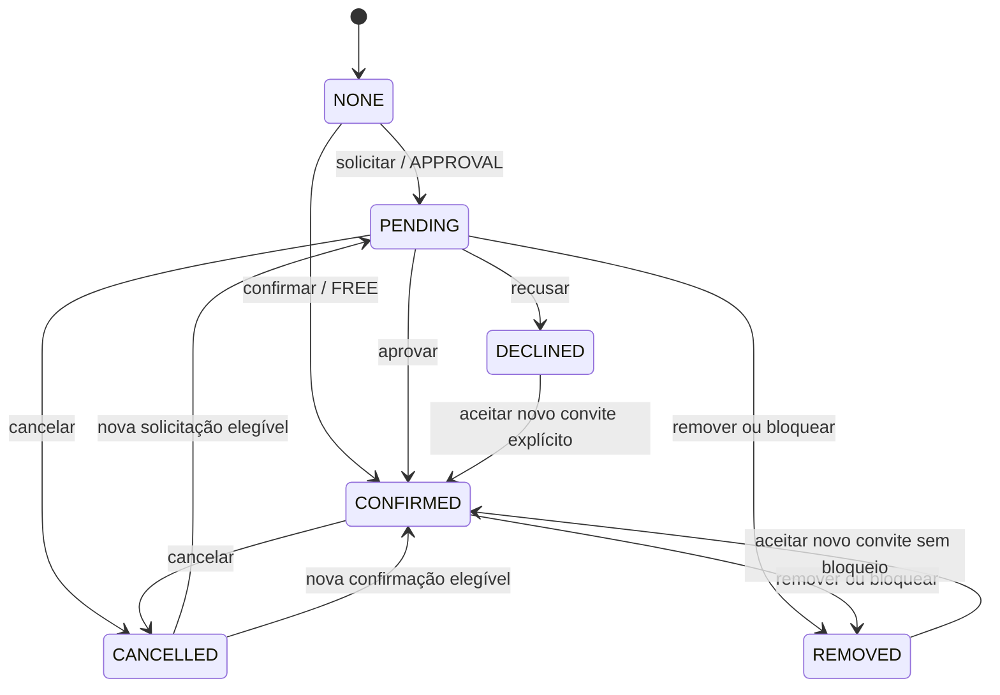

# ADR 0011 — Participação, capacidade e check-in

Status: implementado no PR-06. Data: 09/11/2026. Complementa ADR0009/0010, sem novo domínio de eventos ou serviço externo.

## Estado e intenção

Uma linha `participation.members` por Experience/usuário. `interested` é independente: marcar interesse não solicita aprovação nem ocupa vaga, e cancelar uma participação não remove interesse automaticamente. O estado `NONE` com interesse ativo representa conceitualmente INTERESTED. Estado de presença separado em `participation.checkins`; CONFIRMED não significa que a pessoa compareceu.

Convite válido pode confirmar também NONE/PENDING/CANCELLED, sujeito à capacidade. Bloquear grava REMOVED e bloqueio contextual; desbloquear não restaura estado, convite ou check-in. DECLINED/REMOVED impedem reentrada autônoma: novo convite é uma decisão explícita do organizador. Rejeitar solicitação revoga convites pendentes anteriores. Organizador é somente o criador nesta V1: gerencia e confere presença, não pode confirmar/convidar/remover a si mesmo, não ocupa assento e não aparece como participante inventado. Delegação de responsáveis é futura.

## Audiência e convites

PUBLIC/UNLISTED usam FREE, APPROVAL ou INVITE; regras de descoberta anteriores permanecem. PRIVATE exige convite individual: mesmo que um rascunho tenha sido configurado antes como FREE, sua política efetiva passa a INVITE. UUID/link nunca concede acesso. Convite PENDING não expirado ou participação CONFIRMED concede leitura privada autenticada; bloqueio, conta do criador indisponível e moderação negam leitura. Conteúdo cancelado/arquivado mantém somente o histórico redigido autorizado pelo domínio Experiences. Cancelar/remover confirmação privada retira o acesso derivado.

`participation.can_access` é compartilhada por detalhes, capa, Participation e Agenda. Bloqueio contextual também exclui Home, Radar, busca, Flows e leituras de mídia Flow, inclusive tickets anteriores. Não é Social Graph nem bloqueio global de pessoa. Contas suspensas/desativadas/deletadas não autenticam nem aceitam convite/check-in; alvo inativo não recebe novo convite/aprovação. Confirmações antigas de conta restrita continuam ocupando capacidade até remoção/cancelamento explícito, evitando disponibilizar assentos sem decisão auditada.

Convites por UUID interno conhecido ou @handle exato, sem busca de perfis/telefones/contatos. Erro uniforme `invitation_unavailable` para inexistente/inativo/bloqueado/inelegível, com limite persistido por ator e limite de origem. Um convite atual por Experience/destinatário; repetir pendência válida não duplica. Renovar terminal/expirado cria novo ID e versão, preservando fatos na auditoria. TTL default72h,1..168h e nunca além do fim. Aceitar consome vaga; lotação preserva convite. Somente destinatário aceita/recusa, somente organizador revoga PENDING. Aceito é revogado removendo participação, para não fingir que revogar um convite desfaz presença silenciosamente.

## Capacidade e transação

Capacidade pertence à Experience existente, nullable=ilimitada. Somente CONFIRMED ocupa assento. Contagem vem de PostgreSQL, sem contador Redis ou duplicação assíncrona. Toda escrita trava sessão/conta Identity, depois a linha Experience; confirmações, convites, aprovações, cancelamentos e capacidade têm o mesmo ponto de serialização. Triggers PostgreSQL impedem overbooking por escritor que omita a política Go e reduções abaixo do confirmado. Testes disputam última vaga no banco real.

Configuração tem ETag composto `"settingsVersion-experienceVersion"`. Redução abaixo do confirmado retorna409 sem remover pessoas; não existe waitlist. Alterar modalidade não expulsa confirmações nem apaga solicitações. Alteração dedicada de capacidade incrementa versão, auditoria e outbox de Experiences (`experience.capacity_updated`); o PUT geral continua protegendo capacidade publicada. Retorno412 exige buscar/revisar antes de salvar novamente.

Mutações, auditoria, outbox e recibo idempotente são atômicos. UUID de intenção + hash do recurso/operação/corpo,24h; mesma chave/dados retorna o recibo original, não uma consulta do estado atual. Outra intenção/dados com a mesma chave retorna409. Cliente usa uma chave por intenção e a mantém em timeout, sem replay automático de POST. Consultar situação atual depois de mutações ambíguas. Quota é persistida fora da transação de domínio para também contar tentativas recusadas. Escritas têm contexto5s/lock timeout2s; consultas paginadas limitadas a50 e contexto3s. Nenhum publish direto no RabbitMQ dentro da transação.

## Check-in escolhido

Participante confirmado, autenticado e na janela solicita um código aleatório base32 de16 caracteres/80bits. Organizador confere a pessoa no local e digita esse código na tela da própria Experience; resposta identifica pessoa por nome público/handle/ID interno. Sem câmera, GPS, contatos ou novo fornecedor. O organizador é responsável pela conferência presencial: código compartilhado remotamente não é prova criptográfica de localização ou de identidade civil.

HMAC com separação de domínio no banco, vinculado a Experience/usuário/sessão emissora. TTL default120s/configurável30..300s; janela default30min antes do início até fim, antecedência0..120min. Emitir outro invalida o anterior; não há retry automático de emissão após timeout. Cada validação reavalia criador, sessão emissora, conta, CONFIRMED, bloqueio, lifecycle, moderação, horário, hash/validade/consumo. Lock da Experience serializa validação com cancelamento/remoção. Código usado com nova intenção retorna409; a mesma chave de validação retorna o recibo original.

Um registro de check-in por pessoa/Experience, com versão e trilha; revogar presença invalida credencial atual. Nova emissão/validação elegível pode registrar novamente na mesma linha com versão maior. Cancelar/remover/bloquear revoga credencial e presença na mesma transação. Cancelamento/moderação da Experience impede novas validações imediatamente; histórico de presença não é apagado ou convertido em participação. Credencial nunca concede vaga ou audiência privada.

Código bruto fica somente na resposta e memória transitória do app, nunca em recibo, audit, evento ou logs. Credenciais expiradas são podadas após1 dia. Dados da tela são apagados em background/conta/saída/expiração; detalhe privado de convidado também é retirado em background/saída e em até60s, exigindo revalidação. Respostas já entregues não podem ser recuperadas.

## Eventos e fronteiras futuras

Fatos implementados: participation.interested/interest_removed/requested/confirmed/cancelled/declined/removed/blocked/unblocked/settings_updated, invitation.created/accepted/declined/revoked, checkin.completed/revoked. Emissão de credencial é somente auditada (`checkin.credential_issued`), sem evento com segredo. Envelope existente + payload Participation v1, apenas IDs/versão/estado. Versão é do recurso referenciado; não constitui sequência global entre participação/convite/check-in. Outbox conserva entrega futura pelo mecanismo existente; consumidores devem usar inbox e reconsultar autorização antes de notificar ou expor conteúdo privado. Push/relay novo não foi construído.

CONFIRMED poderá ser um sinal para Event Space, nunca permissão suficiente. Futuras APIs de entrada/publicação/chat/mídia devem reavaliar bloqueios, conta, audiência/lifecycle/moderação e revogação no backend. Sem dependência de tabelas de Social/Chat/Event Space inexistentes. CONFIRMED e check-in não comprovam compra/pagamento/validade de ingressos externos.
